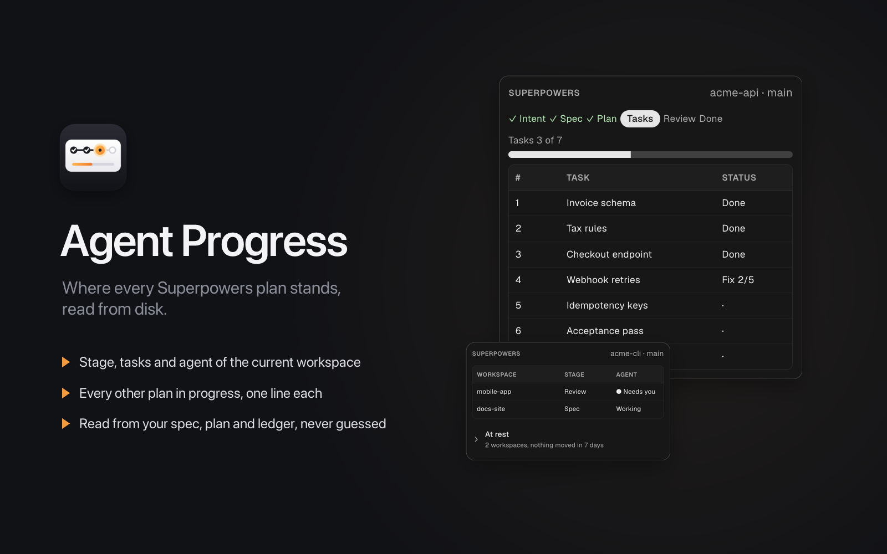

# Agent Progress for Superpowers



**This plugin requires [Superpowers](https://github.com/obra/superpowers).** It shows where each Superpowers plan stands, and it has nothing to show in a workspace that has no Superpowers files. It requires Orca 1.4.259 or later and was tested on Orca 1.4.261 with Superpowers v7.0.2.

It reads the files Superpowers leaves in your workspaces (spec, plan, and the subagent-driven-development ledger) and turns them into one card per project: the stage, the tasks, the agents of the project, and whether something is waiting for you. A status bar item follows the project of the active workspace.

## Install

From the command line:

```sh
orca plugin install eRom/orca-plugin-agent-progress-sp
```

Orca shows the access the plugin asks for (see [Access requested, and why](#access-requested-and-why)) and enables it once you approve. The **Agent Progress** panel then appears in the right sidebar, and the status bar item appears when the project of the active workspace has live work.

**Show the worktrees Superpowers creates.** In Claude Code, Superpowers puts its worktrees in `.claude/worktrees/`, which Orca hides by default. The plugin only reads the workspaces Orca lists, so the ledger of such a worktree stays out of sight and the work stays at the Plan stage in the main checkout. To show them, open Orca's settings, go to **Worktrees from other tools** and turn on **Claude Code**. Worktrees created elsewhere (for example `.worktrees/`, the fallback Superpowers uses with Codex) need an **Add folder…** entry with the absolute path of the folder that holds them, one per repository.

## What it shows

- **The card of the current project**: the project of the active workspace, main checkout and worktrees together. A stage strip, the task list with its state, the documents (spec, plan, ledger) as buttons that open in an Orca tab, and the agents of the project, each with a button that brings its terminal to the front. When the project has several live pieces of work, a **Work** menu switches between them, and the work whose ledger is open comes first.
- **Agents and worktrees**: Orca attaches an agent to the workspace of its terminal. When Superpowers moves an agent into a worktree, its terminal stays in the main checkout, so the card lists the agents of every workspace of the project and names the workspace of a terminal that is not the one carrying the work, for example `Claude needs you for 2m · in main`.
- **Other work**: a row under the card counts the other projects that have live work and how many of them need you. Unfold it for a table; activating a row switches Orca to the workspace that carries that project's work.
- **At rest**: workspaces whose Superpowers files have not moved for 7 days, with their last document and its age. A workspace is left out when another workspace of the same project has live work (for example a main checkout whose plan runs in a worktree).
- **The status bar**: one item, shown only when the project of the active workspace has live work. Text: the stage name, `Plan · N tasks`, or `Tasks k/N` for the work shown first on the card, where k is the current task (the first one not done) and N the number of tasks (plus ` · fix a/b` when the current task is in a fix round). It turns to the warning tone when an agent of the project needs you. The status bar `Tasks k/N` shows the current task, while the progress bar in the panel counts tasks done.

A workspace with no Superpowers file appears nowhere.

## Update delay

Updates within 3 seconds: the plugin re-reads the Superpowers files of your workspaces every 3 seconds, and only the files that changed. Agent states arrive as Orca emits them. The workspace list is refreshed on workspace changes and every 27 seconds.

## How a stage is read

Stages are computed on every re-read, in this order of priority:

| Stage | Evidence |
|---|---|
| Done | The plugin had seen the plan's ledger, and the ledger is gone. |
| Review | A ledger is present and every task of the plan is done. |
| Tasks | A ledger is present and at least one task is not done. |
| Plan | A plan is present, no ledger yet. |
| Spec | A spec is present, and no plan points to it. |
| Intent | An intent record alone. |

- **Done means the final review passed and the plan's ledger was removed, not that the branch was merged.** Superpowers deletes the ledger only at the end of a clean final review. If a ledger the plugin had seen disappears before all its tasks were recorded done, the card says so (for example `6 of 7 tasks recorded`), because real ledgers often miss the `complete` line of their last task.
- **Intent** only appears when work has intent records (a non-standard workflow). Standard Superpowers work starts at Spec.
- A piece of work that started further along (a plan without a spec) shows the missing earlier stages dimmed, without a check mark.
- Done is remembered in the plugin's own storage, so it survives a restart of Orca. It only covers what happened since the plugin was installed: work finished earlier is never shown as Done: with its ledger already gone, it appears at the Plan or Spec stage, stays live for 7 days counted from the date in its file name, then goes to rest.

### Live or at rest

Work is live when its last movement is less than 7 days old, or when it reached Done less than 7 days ago. The last movement is the most recent of: the ledger's modification date, and the `YYYY-MM-DD` at the start of the file name of each intent, spec and plan (the date on disk is only used when a name carries none). File names are used rather than disk dates because a fresh worktree or a `git pull` rewrites disk dates. A workspace is live if it has at least one live piece of work. An agent working in a workspace does not make its work live.

### Ledgers: what is understood

A ledger is the `progress.md` file under `.superpowers/sdd/`, written by a model in prose. The plugin only trusts the forms it can read safely:

- The first line `# SDD ledger - plan: <path>` (hyphen, em dash or en dash) names the plan.
- Task lines `Task N: ...` or `Tasks N: ...`, with an optional list bullet, and with `N` as a number (optionally with a letter, such as `3a`) or a group (`3+4`, `2-4`, `1, 3a`), which is unfolded.
- `Task N: complete ...` marks the task done. Done is final: no later line undoes it.
- `Task N: fix round a/b ...` marks a task in a fix round.
- `Task N: dispatched`, `implementer`, `implemented`, `review`, `re-review` mark a task in progress.
- `Task N: minor`, `parked`, `ruling`, `released`, `note`, `base` are journal lines and change nothing.

Any other task line is counted as "not understood" and never guessed: the card shows the count, and the plugin never turns an unknown line into a state. A plan without a ledger shows its tasks as not started.

## Access requested, and why

The plugin runs as a trusted worker and declares exactly four capabilities, and no hook:

| Capability | Why |
|---|---|
| `workspace:read` | List your workspaces and know which one is active. |
| `agent:read` | Read the state of the agents (`blocked` and `waiting` mean "needs you"). |
| `workspace:write` | Open a document in an Orca tab, bring a terminal to the front, switch to a workspace, and toggle the right sidebar. Despite its name, this capability is not used to write files. |
| `storage:own` | Remember which ledgers were seen, to recognize Done after a ledger disappears. |

Reading the files is done by the worker itself: it reads only `docs/superpowers/intents`, `docs/superpowers/specs` and `docs/superpowers/plans`, and the ledgers under `.superpowers/sdd` of your local workspaces, plus the documents those files point to by absolute path.

## Reads only

The plugin writes nothing in your workspaces and adds nothing to your agents' context: it never sends them a message and never changes their prompt. It makes no network call. Its only persistent write is its own storage in Orca.

## Limits

- **Local workspaces only.** Workspaces over SSH or WSL are not read.
- **The status bar item toggles the right sidebar.** No Orca plugin can open its own panel from the status bar, so a click opens or closes the right sidebar, where the Agent Progress panel lives.
- The ledger and spec formats live in the text of the Superpowers skills and can change. This plugin was tested against Superpowers v7.0.2.

## Uninstall

```sh
orca plugin uninstall <plugin-key>
```

The key is the one shown by `orca plugin list`. Uninstalling removes the plugin's files and its approval. The plugin never wrote anything in your workspaces, so there is nothing else to clean up.

## Development

```sh
orca plugin test . --json          # tests
bunx tsc -p .                      # type check
orca plugin validate . --json      # manifest
orca plugin check . --json         # panel scenarios (src/panel.check.ts)
bun scripts/audit-ledgers.ts <root>...
```

The audit script reads every `.superpowers/sdd/**/progress.md` under each root (or the top-level `*.md` files of a corpus folder) and prints, per ledger, `done`, an independent count of `complete` task numbers, and the number of task lines not understood. It exits with 1 if the parser and the independent count disagree.

To try the plugin, install a frozen copy with `orca plugin install <folder>`. Do not `orca plugin dev load` a folder whose dot-folders change (`.superpowers/`, `.codegraph/`): Orca ties the approval to the whole folder, and any change disables the plugin until you approve it again.

### Listing media

The icon, the cover and the screenshots of the plugin page live in `media/`. They are built from real renders of the panel (the scenarios of `src/panel.check.ts`, with demo data) laid on a plain backdrop; nothing is drawn by hand except the icon (`media/icon.svg`).

Agent Progress for Superpowers is a community plugin, not made or endorsed by Stably or by the Superpowers authors.

## License

[MIT](LICENSE)
